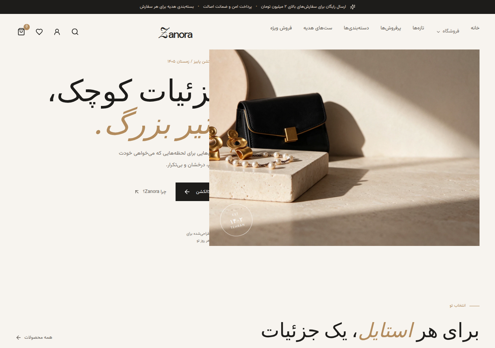
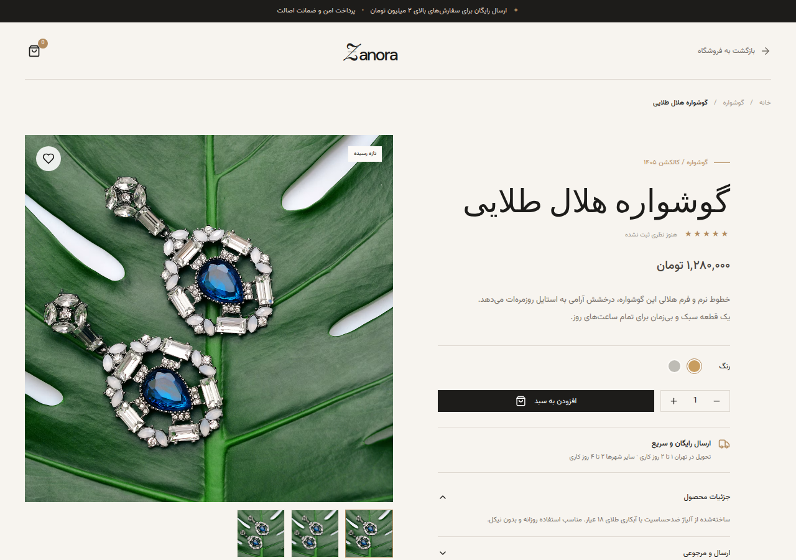
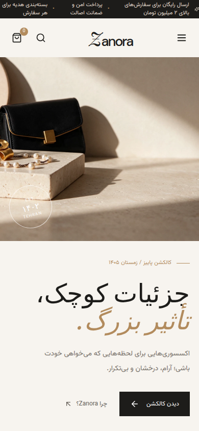
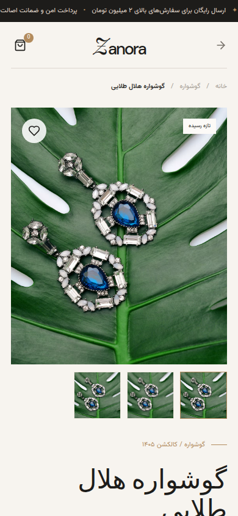
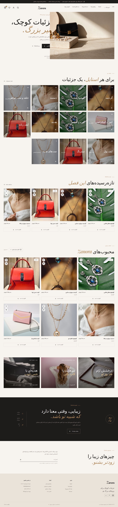

# Zanora Visual Demo

These screenshots were captured from the running Zanora demo after the catalog expansion and responsive storefront refresh.

## Desktop

## Mobile

## Full storefront

The full-page capture documents the complete editorial homepage, including the category grid, New Arrivals, expanded product grid, collections, story section, newsletter, and footer.

## Capture details

- Desktop viewport: 1280 × 900 pixels
- Mobile viewport: 390 × 844 pixels
- Capture route: `/` and `/product/1`
- Product catalog shown: 18 curated fallback products across earrings, necklaces, bracelets, and bags
- The screenshots are repository artifacts for product review and README rendering; the live demo remains the source of truth for interactions.
